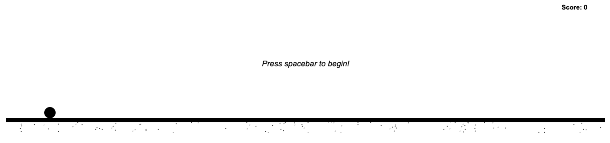

# Bouncing Ball-Game

This is a brief project I created in high school. It is a (VERY) simplified version of the dinosaur game which appears when there is no internet connected in the Chrome browser. This is not a good representation of my current coding skills--I look back at the code (and the below summary) now and laugh, but this was a great experience at the time!

## Learning JavaScript

For my final project, my main goal was to learn JavaScript. I used the website Codecademy, which
teaches people how to code using hands-on lessons. I began with the beginner level “Learn JavaScript” course,
which covered many things that we talked about in class with Visual Basic such as variables and conditional
statements, functions, objects, scope, and loops. This course also covered something new for me: iterator
statements that are used to cycle through an array without a loop. After completing this course, I started “Learn
Intermediate JavaScript.” The lessons I went through in this course were “Classes,” “Modules,” and “Promises,” and it heavily focused on synchronicity and asynchronicity. The classes taught were not nearly as powerful as
the ones we learned in Visual Basic, and are very similar to objects. Modules are what is imported at the top of
a program, and how to import and create modules were covered. The final lesson I completed was the
promises lesson. A promise statement checks if a process throws an error, and runs different code depending
on if it does or not. In practice, I found them very confusing and hard to implement in the code. At this point it
was the last week of class, so I stopped learning the course and began working on my smaller coding project.

Before talking about that, however, I would like to convey my opinion of JavaScript. There are many things that I
dislike about JavaScript. First of all, JavaScript having oddly cased methods and variables is very frustrating. Multiple times an entire section of code has not run because I wrote `math.Floor` instead of `Math.floor`. Worst of all, often when JavaScript throws an error it is vague and unhelpful as to what and where it is. In retrospect, I think I would have been better off learning Java instead of JavaScript. This is not because of these aforementioned frustrations, as I am sure Java would be similar in that respect, but because JavaScript is primarily used for websites, which is not an area I am interested in. Java is a language that is used more in applications and software engineering, which I think would have served me better than JavaScript will in the future.

## The Project Itself

My coding project is a game called “Bouncing Ball Game.” My goal when I started this project was to
make a game very similar to Chrome Dino, with a player-controlled character jumping over objects in a
side-scroller. I used Visual Studio Code for my environment/compiler, since regular Visual Studio does not
support JavaScript and the built-in Codecademy environment is blocked on the school wifi. I originally was
skeptical about the capabilities of this program, but it ended up being easy to work in and more than powerful
enough for all my needs. 

I originally thought that the basic game would be easy to create, and planned to add
features such as crouching and more precise obstacle spawning, but getting the basic mechanics down turned
out to be harder than I thought. Things I thought would be difficult, such as jumping and drawing the player,
ended up being relatively easy. What ended up taking the most time was getting the obstacles to properly
spawn and collision detections. I had to work out many errors and rework the logic several times before I was
able to get the obstacles to spawn smoothly, and had to rewrite my collision detection if statement a few times
as well. Additionally, for some reason, JavaScript cannot handle a “while true” loop. Every time I attempted to
implement one, the browser would not load. To get around this, I initially used a for loop looping to an extremely
large number. However, after researching the problem I determined a better way to do it is the built-in
requestAnimationFrame function. For some reason, this accomplishes exactly what a while true loop should
without the browser crashing. 

There are a couple of things I was unable to get to work. First of all, it can be observed that the obstacles and the ground accents (the dots below the ground line) have intense motion blur, an effect that gets worse as the game progresses and scrolls faster. In the actual Chrome Dino, the obstacles remain crisp even as the game speed increases. This is important not only aesthetically, but also to make sure the player can easily judge where the obstacle is to properly time their jump. Even after significant research, I did not find a way to fix the problem. Next, I was unable to get the game to restart if the player presses the spacebar after the game ends. For some reason, the game immediately restarted after ending whenever I tried to implement this feature, despite my carefully resetting all the variables to where they were at the beginning of the game. Lastly, when initially trying to get the game to start with the spacebar, I had the spacebar key press change a variable, which would make the game function run. However, for some reason the function did not redefine the variable, even though it was declared in the global scope. I ended up just calling the game function in the key press function, which worked flawlessly. Strangely, I did not come across the same problem using variables in any other function. Overall, I greatly enjoyed creating this game. I have learned a lot about JavaScript and coding in general from this whole process.
